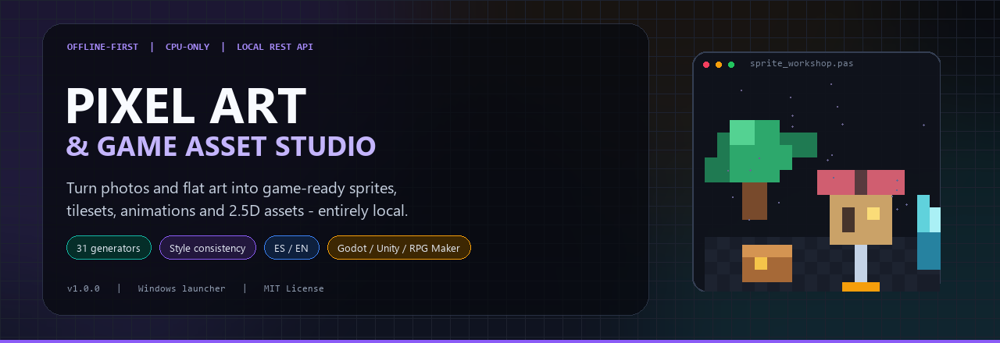
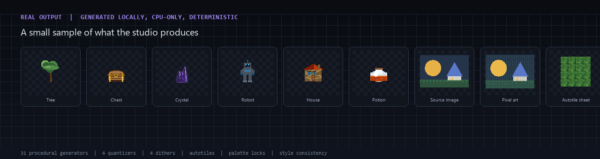
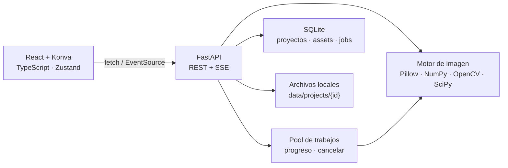

<p align="center">
  
</p>

<h1 align="center">Pixel Art &amp; Game Asset Studio</h1>

<p align="center">
  <strong>Estudio de escritorio offline y CPU-only para convertir imágenes y arte plano en assets listos para tu juego.</strong><br>
  Pixel art · sprites · tilesets · procedural · falso 3D · animación · consistencia de estilo · exportación
</p>

<p align="center">
  
  
  
  
  
  
  
  
  
  
</p>

<p align="center">
  <a href="README.md">🇬🇧 Read in English</a>
</p>

---

## ✨ ¿Por qué este proyecto?

La mayoría de herramientas para convertir imágenes a pixel art son servicios web, APIs en la nube o pipelines que necesitan GPU. **Pixel Art & Game Asset Studio** funciona de otra forma:

- **100 % local.** Las imágenes, proyectos, paletas, exportaciones y SQLite se quedan en tu equipo.
- **Sin GPU.** Pillow, NumPy, OpenCV y SciPy procesan todo en CPU.
- **Determinista.** La misma semilla, imagen y ajustes producen siempre exactamente los mismos píxeles.
- **Pipeline completo.** Convertir → extraer → empaquetar → animar → exportar, con versiones de proyecto y presets para motores.
- **Listo para Windows.** Incluye `PixelArtStudio.exe`, scripts `.bat` y un instalador de un solo comando.
- **Bilingüe.** Cambia toda la interfaz entre **Español** e **English** desde la barra superior.

Sin cuentas. Sin telemetría. Sin CDN, fuentes remotas, IA en la nube ni descargas en tiempo de ejecución.

---

## 🚀 Características

| Módulo | Qué permite hacer |
| --- | --- |
| **Panel** | Resumen en vivo de proyectos, assets, memoria, CPU, trabajos, benchmarks y uso de disco. |
| **Imagen → Pixel Art** | Carga una imagen, ve la fuente al instante, pulsa **Procesar** y sigue el progreso real. Escalado Lanczos/bicúbico/bilineal/nearest, cuantización median cut, octree, adaptativa o K-means con semilla, dithering Floyd–Steinberg, Atkinson, JJN o Bayer, ajustes de color, denoise, preservación de bordes, bloqueo de paleta, transparencia y cuadrícula de píxeles. |
| **Extractor de sprites** | Segmenta hojas por alfa, color de fondo, color objetivo o umbral; componentes conectados + unión de separaciones; recorte, normalización, hashes, detección de duplicados y empaquetado de una nueva hoja. |
| **Generador de tilesets** | Corta cuadrículas uniformes con margen/espaciado/desplazamiento, detecta duplicados, genera autotiles de 16 máscaras, hace tiles sin costuras (con medición antes/después), recolorea y exporta hojas. |
| **Generador procedimental** | 31 generadores deterministas con semilla: naturaleza, fantasía, entorno y ciencia ficción. Restricción de paleta, estilos, variantes y parámetros definidos por un esquema dinámico. |
| **Laboratorio Falso 3D** | Proyecciones 2.5D isométricas, cenitales y laterales con extrusión, luz de relieve, perspectiva, sombras y suelo. Incluye mapas de altura por luminancia. |
| **Estudio de animación** | Línea de tiempo, reproducción, FPS, bucle, reordenar/duplicar/subir frames, plantillas (idle, walk, run, jump, fall, attack, hurt, death) y exportación a hoja, GIF, WebP o JSON. |
| **Biblioteca de assets** | Búsqueda, filtros, favoritos, etiquetas, inspector de detalle, acciones por lotes, empaquetado de sprites y exportación ZIP en segundo plano con manifiestos para motores. |
| **Consistencia de estilo** | Perfil por proyecto: paleta, presupuesto de color, escala de píxel, contorno interior, pasos de sombreado, dithering Bayer y ajustes de color. Aplícalo y mide la consistencia con recomendaciones. |
| **Proyectos** | Crear, editar, duplicar, importar/exportar `.pasproject.zip`, autoguardado, snapshots (15 por proyecto) y restauración. |
| **Ajustes** | Límites del motor, hilos, autoguardado, color de acento, reducir movimiento, paletas, trabajos, limpieza, benchmarks y diagnóstico. |
| **Lanzador** | `PixelArtStudio.exe` arranca el servidor local oculto, espera a que esté sano y abre el estudio. |

### Puntos destacados

- **Algoritmos reales, no placeholders** — cada módulo crea y guarda imágenes y metadatos reales.
- **Proyectos aislados** — assets, paletas, capas, animaciones y exportaciones viven dentro de cada proyecto.
- **Exportación para motores** — PNG, JPEG, BMP, WebP, GIF, JSON, CSV y ZIP con presets **Generic**, **Godot 4**, **Unity** y **RPG Maker**.
- **Consistencia visual** — un único perfil mantiene coherente el arte de todo el juego.
- **Semillas deterministas** — las familias procedurales son reproducibles en cualquier equipo.
- **API REST local + SSE** — la interfaz y la documentación usan la misma API; las tareas largas muestran progreso y se pueden cancelar.
- **Seguro por diseño** — servidor solo en loopback, validación de subidas, protección contra path traversal, ZIPs seguros y cero llamadas salientes.

---

## 📸 Interfaz y ejemplos reales

<p align="center">
  
</p>

La imagen anterior la generó la propia aplicación: seis props procedurales con semilla, una imagen fuente, su conversión a pixel art y una hoja de autotiles de 16 máscaras. La interfaz es un espacio de trabajo oscuro tipo escritorio con barra lateral, barra superior, lienzo Konva, panel de propiedades, línea de tiempo, zoom/pan, cuadrículas, deshacer/rehacer y atajos.

> La aplicación es totalmente local, por lo que no hay demo alojada. Clónala y ejecuta `PixelArtStudio.exe` (o `start.bat`) para probarla.

---

## 🧱 Tecnologías

### Frontend

| Tecnología | Función |
| --- | --- |
| React 18 | Interfaz |
| TypeScript 5.6 (estricto) | Tipado |
| Vite 5 | Desarrollo / build |
| Tailwind CSS 3 | Sistema de diseño oscuro |
| Zustand 5 | Estado del estudio |
| Konva 9 | Lienzo, zoom/pan y capas |
| React Router 6 | 11 páginas |

### Backend

| Tecnología | Función |
| --- | --- |
| Python 3.10+ | Runtime |
| FastAPI 0.162 | API REST local |
| Uvicorn 0.41 | Servidor ASGI |
| Pillow 13 | Entrada/salida de imágenes |
| NumPy 2.5 | Matemática de píxeles |
| OpenCV 5 (headless) | Escalado, filtros, bordes |
| SciPy 1.18 | Morfología, dilatación, componentes conectados |
| SQLite | Proyectos, assets, trabajos, backups |
| psutil | Métricas del sistema |

**Lanzador:** ejecutable GUI de C# compilado con .NET Framework 4.8 (incluido `PixelArtStudio.exe`; código en `launcher/`).

---

## 🏗 Arquitectura



Estructura resumida:

```text
frontend/            SPA React + Vite
  src/api/           cliente REST y SSE
  src/components/    Shell, Sidebar, TopBar, ImageStage, Workspace, UI kit
  src/pages/         Dashboard, PixelArt, Sprites, Tileset, Procedural,
                     False3D, Animation, Library, Style, Projects, Settings
  src/store/         Zustand (proyectos, assets, ajustes, idioma)
  src/i18n.tsx       diccionario español/inglés + Localize
backend/
  app/routers/       API REST
  app/services/      pixelart, sprites, tileset, procedural, pseudo3d,
                     animation, style, palettes, images, exporter, storage
  app/jobs.py        pool de trabajos, SSE, cancelación
launcher/            lanzador C#, icono y metadatos
docs/                informes, banner y esquema OpenAPI
PixelArtStudio.exe   lanzador listo para usar
```

---

## 💻 Requisitos

| Requisito | Mínimo | Probado con |
| --- | --- | --- |
| Sistema | Windows 10/11 (lanzador) | Windows 10 19045 |
| Python | 3.10+ | 3.13.7 |
| Node.js + npm | 18+ | Node 22.19 / npm 10.2 |
| RAM | 8 GB recomendados | 7,8 GB en el equipo de pruebas |
| GPU | No necesaria | Solo CPU |
| Disco | ~500 MB con dependencias | — |
| Red | Solo para la primera instalación | En ejecución, offline |

El backend y el frontend son multiplataforma; los `.bat` y el `.exe` incluidos son para Windows. En macOS/Linux usa los comandos manuales.

---

## 📦 Instalación

### Windows — ruta recomendada

```bat
git clone https://github.com/IvanITT/PixelArtStudio.git
cd PixelArtStudio
install.bat
```

`install.bat` realiza toda la puesta en marcha:

1. Comprueba Python y npm.
2. Crea `backend\.venv`.
3. Instala las dependencias Python fijadas.
4. Instala las dependencias del frontend.
5. Compila la SPA en `frontend\dist`.
6. Ejecuta la suite de tests.

Después abre **`PixelArtStudio.exe`**. Arranca el servidor local oculto, espera a `/api/health` y abre:

**http://127.0.0.1:8765**

Si SmartScreen avisa porque el lanzador no está firmado, elige **Más información → Ejecutar de todas formas** (el código y el script de compilación están incluidos).

### Instalación manual

```bat
cd backend
python -m venv .venv
.venv\Scripts\activate
pip install -r requirements.txt

cd ..\frontend
npm install
npm run build

cd ..
backend\.venv\Scripts\python.exe -m uvicorn app.main:app --host 127.0.0.1 --port 8765 --app-dir backend
```

Abre <http://127.0.0.1:8765>. Documentación de la API: <http://127.0.0.1:8765/api/docs>.

### macOS / Linux

```bash
python3 -m venv backend/.venv
source backend/.venv/bin/activate
pip install -r backend/requirements.txt
(cd frontend && npm install && npm run build)
backend/.venv/bin/python -m uvicorn app.main:app --host 127.0.0.1 --port 8765 --app-dir backend
```

---

## 🕹 Inicio rápido

1. Arranca con **`PixelArtStudio.exe`** o `start.bat`.
2. Abre **Imagen → Pixel Art** e importa PNG/JPEG/WebP/BMP/GIF (o pulsa `Ctrl+U`).
3. La imagen fuente aparece inmediatamente; ajusta tamaño, cuantizador, paleta y dithering.
4. Pulsa **Procesar** y sigue el porcentaje y las fases reales.
5. Compara **Fuente / Resultado** y usa **Guardar como asset** o **Descargar PNG**.
6. Continúa con **Extractor de sprites**, **Tilesets**, **Procedimental**, **Falso 3D** o **Animación**.
7. Usa **Consistencia de estilo** para aplicar una paleta, contorno y escala comunes.
8. Exporta desde la **Biblioteca de assets** con presets Godot, Unity, RPG Maker o genéricos.

> En una instalación nueva, la primera importación crea y selecciona automáticamente **“Mi proyecto”**, para que nunca te quedes sin proyecto activo.

---

## ⌨️ Comandos

| Comando | Función |
| --- | --- |
| `PixelArtStudio.exe` | Servidor oculto + navegador (recomendado) |
| `install.bat` | Instalación completa la primera vez |
| `start.bat` | Arranque por consola y apertura del navegador |
| `stop.bat` | Detiene el proceso del puerto 8765 |
| `update_local.bat` | Detiene, actualiza dependencias, recompila y prueba |
| `run_dev.bat` | Desarrollo: FastAPI `:8765` + Vite `:5173` |
| `build_exe.bat` | Recompila `PixelArtStudio.exe` |

### Desarrollo del frontend

```bat
cd frontend
npm run dev        :: Vite en 127.0.0.1:5173, proxy /api a 8765
npm run typecheck
npm run build
```

---

## 🔌 API

El servidor escucha **solo en 127.0.0.1**. Swagger: `http://127.0.0.1:8765/api/docs` · OpenAPI: `/api/openapi.json` · esquema estático: [`docs/api-openapi.json`](docs/api-openapi.json).

| Método | Endpoint | Descripción |
| --- | --- | --- |
| `GET` | `/api/health` | Motor, versiones, memoria, estado del frontend |
| `GET/PATCH` | `/api/settings` | Límites y apariencia |
| `GET/POST` | `/api/projects` | Listar/crear proyectos |
| `POST` | `/api/projects/{id}/assets/upload` | Subida validada de imagen |
| `POST` | `/api/pixelart/preview` | Vista previa síncrona (caché) |
| `POST` | `/api/pixelart/job` | Procesado en segundo plano con progreso |
| `POST` | `/api/pixelart/export` | Guardar pixel art como asset |
| `POST` | `/api/sprites/extract` | Segmentar una hoja de sprites |
| `POST` | `/api/sprites/pack` | Empaquetar spritesheet |
| `POST` | `/api/tileset/extract` | Extracción por cuadrícula |
| `POST` | `/api/tileset/terrain` | Autotiles de 16 máscaras |
| `POST` | `/api/tileset/seamless` | Mezcla sin costuras |
| `GET` | `/api/procedural/catalog` | 31 generadores + parámetros |
| `POST` | `/api/procedural/generate` | Generación con semilla |
| `POST` | `/api/false3d/preview` | Proyección 2.5D |
| `POST` | `/api/animations/{id}/export` | Hoja/GIF/WebP/JSON |
| `POST` | `/api/export/package` | ZIP en segundo plano |
| `GET` | `/api/jobs/{id}/events` | Progreso SSE |
| `GET/PATCH` | `/api/style/{id}` | Perfil de estilo |
| `POST` | `/api/style/apply` | Aplicar estilo |
| `POST` | `/api/style/report` | Métricas de consistencia |

---

## 🎨 Consistencia de estilo

Cada proyecto guarda un perfil con:

- paleta integrada o colores hex personalizados (hasta 128),
- presupuesto de color (0–64),
- escala de píxel (1×–8×, ajuste nearest-neighbour),
- contorno: ninguno / oscuro / claro / personalizado, 1–4 px dentro de la silueta alfa,
- pasos de sombreado (0–8), dithering Bayer ordenado,
- brillo, contraste y saturación.

**Aplicar** ejecuta de forma determinista:

```text
ajuste de escala → color → sombreado → presupuesto de color
→ mapeo de paleta → contorno interior
```

El resultado se guarda como un asset nuevo con auditoría (`colors_before`, `colors_after`, cobertura de paleta, píxeles de contorno y puntuaciones). **Informe** combina la puntuación de cada asset con el solapamiento de paletas:

```text
consistencia = 0,7 × media(asset) + 0,3 × solapamiento de paletas
```

El perfil viaja dentro de los `.pasproject.zip`.

---

## 🌐 Interfaz bilingüe

Cambia **ES / EN** desde la barra superior en cualquier momento. La elección se guarda en `localStorage`; el idioma del navegador decide el inicial. Se traducen navegación, formularios, tooltips, estados vacíos, notificaciones y etiquetas del backend (generadores, parámetros y plantillas). Los nombres de proyectos/assets, etiquetas, semillas, archivos y valores numéricos no se alteran. `<html lang>` se actualiza para accesibilidad.

---

## 📤 Exportaciones

| Formato | Uso |
| --- | --- |
| PNG | Pixel art RGBA, sprites, hojas, tilesets, mapas de altura |
| JPEG / BMP / WebP | Imágenes convertidas y para compartir |
| GIF | Bucles animados (paleta de 256 colores) |
| WebP | Bucles animados con mejor alfa |
| JSON | Metadatos de animación y hojas |
| CSV | Manifiestos de assets/exportación |
| ZIP | Paquetes de proyecto y para motores |

**Presets:** Generic 2D · Generic spritesheet · **Godot 4** · **Unity** · **RPG Maker**.

---

## 🔒 Datos, privacidad y seguridad

Directorio de datos por defecto: `data/` (configurable con `PAS_DATA_DIR`).

```text
data/
  studio.db                 SQLite: proyectos, assets, animaciones, paletas, jobs, backups
  projects/<hex-id>/
    project.json            snapshot portable del proyecto
    assets/                 imágenes finales
    thumbs/                 miniaturas
    sources/                subidas originales
    previews/               cachés y vistas previas
    exports/                paquetes ZIP
    backups/                snapshots (15 por proyecto)
```

- **Solo loopback:** `127.0.0.1:8765`, nunca `0.0.0.0`.
- **Validación de subidas:** decodificación con Pillow, lista de formatos, límites de píxeles y bytes.
- **Rutas seguras:** todo pasa por `safe_join` (sin `..`, rutas absolutas ni traversal).
- **Importación ZIP segura:** layout limitado y validación de identificadores.
- **Sin telemetría, analítica, fuentes externas, CDNs, APIs cloud ni IA externa.**
- **Trabajos locales** con progreso, cancelación y limpieza.

---

## ✅ Tests y benchmarks

```bat
cd backend
.venv\Scripts\python.exe -m pytest -q
```

**Última ejecución: 57 tests correctos** (pixel art y job en segundo plano, sprites, empaquetado, tilesets, autotiles, sin costuras, recoloreado, 31 generadores, falso 3D, animación, exportadores, ZIP de proyecto, seguridad, benchmarks y motor de estilo).

```bat
cd frontend
npm run typecheck
npm run build
```

Build de producción: **231 módulos**, ~573 KB JS (~170 KB gzip), ~38,7 KB CSS.

### Rendimiento

Equipo de prueba: **4 núcleos lógicos, 7,8 GB RAM, sin GPU** (un i5-10400 / 16 GB será más rápido). Fixture sintético de 1024×768.

| Módulo | Tiempo | Memoria pico |
| --- | ---: | ---: |
| Vista previa pixel art (384×288, 24 colores, Floyd) | 476,6 ms | 11,2 MB |
| K-means (256×192, 16 colores) | 273,7 ms | 8,9 MB |
| Extracción de sprites (512×256) | 9,0 ms | 2,3 MB |
| Extracción de tileset (512×512, 32 px) | 145,8 ms | 0,3 MB |
| Autotiles (16 máscaras) | 12,8 ms | 0,1 MB |
| 6 assets procedurales | 36,1 ms | 0,1 MB |
| Proyección falso 3D | 339,5 ms | 12,3 MB |
| Hoja de animación | 1,3 ms | 0,01 MB |
| GIF animado | 16,5 ms | 0,1 MB |
| Exportación ZIP | 6,9 ms | 0,5 MB |
| **Total** | **1.318 ms** | **12,3 MB pico** |

---

## 🧭 Atajos

| Atajo | Acción |
| --- | --- |
| `Ctrl+S` | Guardar proyecto + snapshot |
| `Ctrl+U` | Importar imagen fuente |
| `Ctrl+K` | Ir a la biblioteca |
| `Ctrl+Z` / `Ctrl+Shift+Z` / `Ctrl+Y` | Deshacer / rehacer en el workspace |
| `Esc` | Cerrar modal |

---

## 🖥 Electron (opcional)

Electron **no es necesario**; los `.bat` y `PixelArtStudio.exe` son la vía soportada. Para una app de escritorio única:

1. Compila el frontend y empaqueta el backend con PyInstaller (`pas-server.exe`) o distribuye `backend\.venv`.
2. Lanza el sidecar en un puerto loopback libre desde el proceso principal de Electron.
3. Configura `PAS_DATA_DIR` en `app.getPath("userData")`, espera `/api/health` y carga `http://127.0.0.1:<puerto>`.
4. Usa `contextIsolation: true`, `nodeIntegration: false`, sandbox y CSP estricta.
5. Termina el sidecar al salir y genera un instalador NSIS/portable con `electron-builder`.

El lanzador actual ya cubre servidor oculto, espera de health, apertura del navegador y diagnóstico (`data\launcher-server.log`).

---

## ⚠️ Limitaciones

- Solo CPU por diseño; las fotos grandes se reducen para vistas previas y salidas.
- La segmentación de sprites es heurística: sprites que se tocan o tienen mucho antialiasing pueden requerir otro modo o ajustar la unión.
- Falso 3D es una **simulación 2.5D**; no reconstruye geometría oculta.
- GIF usa paleta de 256 colores; usa WebP u hojas PNG para alfa completo.
- El contorno se aplica dentro de la silueta alfa y se omite en imágenes totalmente opacas; la detección de escala es exacta en arte nearest-neighbour y aproximada en el resto.
- Un solo usuario y solo local: sin colaboración, sincronización ni nube.
- Interfaz pensada para escritorio (mínimo 1024 px).
- El lanzador no está firmado; SmartScreen puede avisar la primera vez.

---

## 🗺 Hoja de ruta

- [ ] Herramientas de dibujo/borrador y onion skinning.
- [ ] Tilesets Wang/edge y autotiles animados.
- [ ] Informes de estilo en segundo plano para bibliotecas grandes.
- [ ] Importación/exportación Aseprite JSON y TexturePacker.
- [ ] Instalador Electron firmado y portable.
- [ ] Aceleración GPU opcional para lotes grandes.

---

## 🤝 Contribuir

Issues y pull requests son bienvenidos.

1. Haz fork del repositorio.
2. Crea una rama: `git checkout -b feature/mi-mejora`.
3. Ejecuta tests y comprobaciones:
   ```bat
   cd backend && .venv\Scripts\python.exe -m pytest -q
   cd ..\frontend && npm run typecheck && npm run build
   ```
4. Mantén la arquitectura y añade tests para cambios de algoritmos.
5. Abre un pull request describiendo el comportamiento y la verificación.

No subas `data/`, `backend/.venv`, `frontend/node_modules` ni `frontend/dist` (están en `.gitignore`).

---

## 📚 Informes de ingeniería

- [Fundación y motor local](docs/reports/phase-1-foundation.md)
- [Pixel art y workspace](docs/reports/phase-2-pixel-art-workspace.md)
- [Sprites y tilesets](docs/reports/phase-3-sprites-tilesets.md)
- [Procedural y Falso 3D](docs/reports/phase-4-procedural-false3d.md)
- [Animación, biblioteca y exportación](docs/reports/phase-5-animation-library-export.md)
- [Proyectos, ajustes y estilo](docs/reports/phase-6-projects-settings-style.md)
- [Interfaz bilingüe](docs/reports/phase-7-bilingual-ui.md)
- [Lanzador ejecutable](docs/reports/phase-8-executable-launcher.md)
- [Informe final](docs/reports/final-report.md)
- [Fix: importación de imágenes](docs/reports/fix-image-import.md)
- [Fix: procesado y progreso](docs/reports/fix-pixelart-processing.md)

---

## 📄 Licencia

Distribuido bajo **MIT License**. Consulta [LICENSE](LICENSE).

Copyright © 2026 **Iván Ortiz**.

## 🙏 Agradecimientos

Construido con [FastAPI](https://fastapi.tiangolo.com/), [Pillow](https://python-pillow.org/), [NumPy](https://numpy.org/), [OpenCV](https://opencv.org/), [SciPy](https://scipy.org/), [React](https://react.dev/), [Vite](https://vitejs.dev/), [Tailwind CSS](https://tailwindcss.com/), [Zustand](https://zustand-demo.pmnd.rs/) y [Konva](https://konvajs.org/).

Los nombres de paletas que referencian hardware clásico son aproximaciones descriptivas; las marcas pertenecen a sus propietarios. No se incluye contenido con copyright.

---

<p align="center">
  <a href="https://github.com/IvanITT/PixelArtStudio/stargazers">⭐ Dar una estrella</a> ·
  <a href="https://github.com/IvanITT/PixelArtStudio/issues">🐛 Reportar un problema</a> ·
  <a href="https://github.com/IvanITT/PixelArtStudio">github.com/IvanITT/PixelArtStudio</a>
</p>
