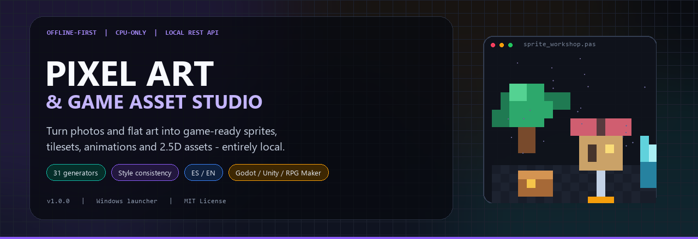
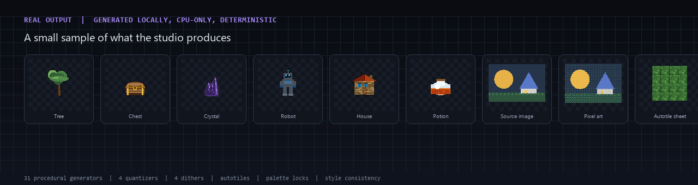
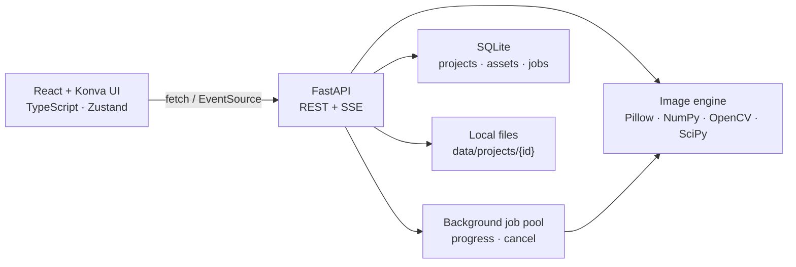

<p align="center">
  
</p>

<h1 align="center">Pixel Art &amp; Game Asset Studio</h1>

<p align="center">
  <strong>An offline-first, CPU-only desktop studio for turning images and flat art into game-ready pixel assets.</strong><br>
  Pixel art conversion · sprites · tilesets · procedural assets · false 3D · animation · style consistency · exports
</p>

<p align="center">
  
  
  
  
  
  
  
  
  
  
</p>

<p align="center">
  <a href="README.es.md">🇪🇸 Leer esta guía en español</a>
</p>

<p align="center">
  <a href="#-why-this-project">Why</a> ·
  <a href="#-features">Features</a> ·
  <a href="#-interface-and-sample-output">Screenshots</a> ·
  <a href="#-installation">Installation</a> ·
  <a href="#-quick-start">Quick start</a> ·
  <a href="#-architecture">Architecture</a> ·
  <a href="#-api">API</a> ·
  <a href="#-tests-and-benchmarks">Tests</a> ·
  <a href="#-roadmap">Roadmap</a>
</p>

---

## ✨ Why this project?

Most image-to-pixel-art tools are web services, cloud APIs or GPU-heavy pipelines. **Pixel Art & Game Asset Studio** is different:

- **100% local.** Images, projects, palettes, exports and SQLite stay on your machine.
- **No GPU required.** Pillow, NumPy, OpenCV and SciPy do all the work on the CPU.
- **Deterministic.** The same seed, source and settings always produce the same pixels.
- **A complete pipeline.** Convert → extract → pack → animate → export, with project versioning and engine presets.
- **Actually usable on Windows.** A prebuilt `PixelArtStudio.exe`, `.bat` scripts and a one-command installer are included.
- **Bilingual.** Switch the entire interface between **Español** and **English** from the top bar.

No account. No telemetry. No CDN, remote fonts, cloud AI or runtime downloads.

---

## 🚀 Features

| Module | What you can do |
| --- | --- |
| **Dashboard** | Live project, asset, memory, CPU, jobs, benchmark and disk usage overview. |
| **Image → Pixel Art** | Load an image, see the source immediately, press **Process** and follow real stage progress. Resize with Lanczos/bicubic/bilinear/nearest, quantize with median cut, octree, adaptive or seeded K-means, dither with Floyd–Steinberg, Atkinson, JJN or Bayer. Colour grading, denoise, edge preservation, palette lock, transparency and pixel-grid snapping. |
| **Sprite Extractor** | Segment sheets by alpha, background colour, target colour or threshold; connected components + merge-gap grouping; trim, normalize, hash, detect duplicates, select and pack a new spritesheet. |
| **Tileset Generator** | Slice uniform grids with margin/spacing/offset, detect duplicates, generate 16-mask autotile terrain sets, make tiles seamless (measured before/after seam error), recolour and export sheets. |
| **Procedural Generator** | 31 deterministic seeded generators: nature, fantasy, environment and sci-fi. Palette restriction, styles, variants and custom parameters generated from a live schema. |
| **False 3D Lab** | Simulated 2.5D isometric/top-down/side projections with extrusion, relief light, perspective, shadows and ground. Includes luminance heightmaps. |
| **Animation Studio** | Timeline, playback, FPS, loop, frame reorder/duplicate/upload, templates (idle, walk, run, jump, fall, attack, hurt, death) and export to sheet, GIF, WebP or JSON. |
| **Asset Library** | Search, filters, favourites, tags, detail inspector, batch actions, sprite packing and background ZIP export with engine manifests. |
| **Style Consistency** | A project-wide profile: palette, colour budget, pixel scale, inside outline, shading steps, Bayer dithering and colour grading. Apply it and measure per-asset consistency with recommendations. |
| **Projects** | Create, edit, duplicate, import/export `.pasproject.zip`, autosave, version snapshots (15 per project) and restore. |
| **Settings** | Engine limits, worker threads, autosave, accent colour, reduced motion, palettes, jobs, cleanup, benchmarks and diagnostics. |
| **Launcher** | `PixelArtStudio.exe` starts the hidden local server, waits for health and opens the studio. |

### Highlights

- **Real algorithms, not placeholders** — every module produces and stores actual image files and metadata.
- **Project isolation** — assets, palettes, layer state, animations and exports live inside each project.
- **Engine-ready exports** — PNG, JPEG, BMP, WebP, GIF, JSON, CSV and ZIP with **Generic**, **Godot 4**, **Unity** and **RPG Maker** presets.
- **Asset Style Consistency** — one profile to keep a whole game's art visually coherent.
- **Deterministic seeds** — procedural families are reproducible across machines.
- **Local REST API + SSE jobs** — the UI and docs drive the same API; long tasks show progress and can be cancelled.
- **Safe by design** — loopback-only server, upload validation, path-traversal protection, safe ZIP import/export and no outbound calls.

---

## 📸 Interface and sample output

<p align="center">
  
</p>

The image above was generated by the application itself: six seeded procedural props, a source image, its pixel-art conversion and a 16-mask autotile sheet. The interface is a dark desktop-style workspace with a sidebar, top bar, Konva canvas, properties panel, timeline, zoom/pan, grids, undo/redo and keyboard shortcuts. The **Style Consistency** page combines a profile editor, target grid and measured report.

> The application is fully local, so there is no hosted demo. Clone it and run `PixelArtStudio.exe` (or `start.bat`) to try it.

---

## 🧱 Tech stack

### Frontend

| Technology | Role |
| --- | --- |
| React 18 | UI |
| TypeScript 5.6 (strict) | Type safety |
| Vite 5 | Dev server / build |
| Tailwind CSS 3 | Dark design system |
| Zustand 5 | Studio state |
| Konva 9 | Workspace canvas, zoom/pan, layers |
| React Router 6 | 11 pages |

### Backend

| Technology | Role |
| --- | --- |
| Python 3.12+ | Runtime |
| FastAPI 0.162 | Local REST API |
| Uvicorn 0.41 | ASGI server |
| Pillow 13 | Image I/O |
| NumPy 2.5 | Pixel math |
| OpenCV 5 (headless) | Resize, filters, edges |
| SciPy 1.18 | Morphology, dilation, connected components |
| SQLite | Projects, assets, jobs, backups |
| psutil | System metrics |

**Launcher:** C# Windows GUI executable built with the .NET Framework 4.8 compiler (prebuilt `PixelArtStudio.exe`; source in `launcher/`).

---

## 🏗 Architecture



```text
frontend/            React + Vite SPA
  src/
    api/             typed REST client and SSE helpers
    components/      Shell, Sidebar, TopBar, ImageStage, Workspace, UI kit, pickers
    pages/           Dashboard, PixelArt, Sprites, Tileset, Procedural,
                     False3D, Animation, Library, Style, Projects, Settings
    store/           Zustand studio store (projects, assets, settings, language)
    i18n.tsx         Spanish/English dictionary and Localize renderer
backend/
  app/
    routers/         health/settings/jobs, projects/assets, pixelart, sprites,
                     tileset, procedural, pseudo3d, animation, export, style
    services/        pixelart, sprites, tileset, procedural, pseudo3d,
                     animation, style, palettes, images, exporter,
                     benchmarks, projectio, storage
    config.py        paths, limits, safe_join, id validation
    db.py            SQLite schema and startup repair
    jobs.py          worker pool, progress events, cancellation
launcher/            C# launcher source, icon and metadata
docs/
  api-openapi.json    generated OpenAPI schema (64 paths)
  assets/            README banner/logo + generator script
  reports/           phase reports, fixes and final test log
PixelArtStudio.exe   ready-to-run Windows launcher
```

---

## 💻 Requirements

| Requirement | Minimum | Tested with |
| --- | --- | --- |
| OS | Windows 10/11 (launcher) | Windows 10 19045 |
| Python | 3.12+ | 3.13.7 |
| Node.js + npm | 18+ | Node 22.19 / npm 10.2 |
| RAM | 8 GB recommended | 7.8 GB test host |
| GPU | Not required | CPU-only |
| Disk | ~500 MB with dependencies | — |
| Network | Only for first install | Runtime is offline |

The backend and frontend are cross-platform; the included `.bat` scripts and `.exe` target Windows. macOS/Linux users can run the manual commands below.

---

## 📦 Installation

### Windows — recommended path

```bat
git clone https://github.com/IvanITT/PixelArtStudio.git
cd PixelArtStudio
install.bat
```

`install.bat` performs the complete first-time setup:

1. Verifies Python 3.12+ and npm.
2. Creates `backend\.venv`.
3. Installs pinned Python dependencies.
4. Installs frontend dependencies.
5. Builds the production SPA into `frontend\dist`.
6. Runs the backend test suite.

Then double-click **`PixelArtStudio.exe`**. It starts the local server hidden, waits for `/api/health` and opens:

**http://127.0.0.1:8765**

If Windows SmartScreen warns about the unsigned launcher, choose **More info → Run anyway** (the full source and build script are in the repository).

### Manual installation

```bat
cd backend
python -m venv .venv
.venv\Scripts\activate
pip install -r requirements.txt

cd ..\frontend
npm install
npm run build

cd ..
backend\.venv\Scripts\python.exe -m uvicorn app.main:app --host 127.0.0.1 --port 8765 --app-dir backend
```

Open <http://127.0.0.1:8765>. API documentation is at <http://127.0.0.1:8765/api/docs>.

### macOS / Linux

```bash
python3 -m venv backend/.venv
source backend/.venv/bin/activate
pip install -r backend/requirements.txt
(cd frontend && npm install && npm run build)
backend/.venv/bin/python -m uvicorn app.main:app --host 127.0.0.1 --port 8765 --app-dir backend
```

---

## 🕹 Quick start

1. Start with **`PixelArtStudio.exe`** or `start.bat`.
2. Open **Image → Pixel Art** and import a PNG/JPEG/WebP/BMP/GIF (or press `Ctrl+U`).
3. The source appears immediately; adjust size, quantizer, palette and dithering.
4. Press **Process** and follow the real percentage/stage progress.
5. Compare **Source / Result**, then **Save as asset** or **Download PNG**.
6. Continue with **Sprite Extractor**, **Tileset Generator**, **Procedural**, **False 3D** or **Animation**.
7. Use **Style Consistency** to apply one palette/outline/pixel-scale profile across assets.
8. Export from the **Asset Library** with Godot, Unity, RPG Maker or generic presets.

> On a completely fresh installation, the first image import creates and selects **“My project” / “Mi proyecto”** automatically, so you never hit a dead end.

---

## ⌨️ Commands

| Command | Purpose |
| --- | --- |
| `PixelArtStudio.exe` | Start hidden server + open browser (recommended) |
| `install.bat` | Full first-time setup |
| `start.bat` | Start via console and open browser |
| `stop.bat` | Stop the process listening on port 8765 |
| `update_local.bat` | Stop, update dependencies, rebuild, re-run tests |
| `run_dev.bat` | Dev mode: FastAPI `:8765` + Vite `:5173` |
| `build_exe.bat` | Rebuild `PixelArtStudio.exe` from `launcher/` |

### Frontend development

```bat
cd frontend
npm run dev        :: Vite on 127.0.0.1:5173, proxies /api to 8765
npm run typecheck
npm run build
```

---

## 🔌 API

The server binds **127.0.0.1 only**. Interactive Swagger: `http://127.0.0.1:8765/api/docs` · OpenAPI: `/api/openapi.json` · static schema: [`docs/api-openapi.json`](docs/api-openapi.json).

| Method | Endpoint | Description |
| --- | --- | --- |
| `GET` | `/api/health` | Engine, versions, memory, frontend status |
| `GET/PATCH` | `/api/settings` | Engine limits and appearance |
| `GET/POST` | `/api/projects` | List/create projects |
| `GET/PATCH/DELETE` | `/api/projects/{id}` | Project detail, update, delete |
| `POST` | `/api/projects/{id}/assets/upload` | Validated image upload |
| `POST` | `/api/pixelart/preview` | Synchronous preview (cache) |
| `POST` | `/api/pixelart/job` | Background preview with progress events |
| `POST` | `/api/pixelart/export` | Save pixel art as an asset |
| `POST` | `/api/sprites/extract` | Segment a sprite sheet |
| `POST` | `/api/sprites/pack` | Pack a spritesheet |
| `POST` | `/api/tileset/extract` | Grid tile extraction |
| `POST` | `/api/tileset/terrain` | 16-mask autotile generation |
| `POST` | `/api/tileset/seamless` | Seamless edge blend |
| `GET` | `/api/procedural/catalog` | 31 generators + parameter schemas |
| `POST` | `/api/procedural/generate` | Seeded generation |
| `GET` | `/api/false3d/templates` | 2.5D templates |
| `POST` | `/api/false3d/preview` | 2.5D projection |
| `GET` | `/api/projects/{id}/animations` | Animation list |
| `POST` | `/api/animations/{id}/export` | Sheet/GIF/WebP/JSON |
| `POST` | `/api/export/package` | Background ZIP export |
| `GET` | `/api/jobs/{id}/events` | Server-Sent Events progress |
| `GET/PATCH` | `/api/style/{id}` | Style profile |
| `POST` | `/api/style/apply` | Apply style to assets |
| `POST` | `/api/style/report` | Consistency metrics |

---

## 🎨 Style Consistency

A style profile is saved per project and includes:

- palette id or custom hex colours (up to 128),
- colour budget (0–64),
- pixel scale (1×–8×, nearest-neighbour block snapping),
- outline: none / dark / light / custom, 1–4 px inside the alpha silhouette,
- shading steps (0–8), ordered Bayer dithering,
- brightness, contrast and saturation grading.

**Apply** runs deterministically:

```text
pixel-scale snap → colour grading → shading → colour budget
→ palette mapping → inside outline
```

The result is saved as a new asset with an audit record (`colors_before`, `colors_after`, palette coverage, outline pixels, scores). **Report** measures every asset and combines per-asset scores with pairwise palette overlap:

```text
consistency = 0.7 × mean(asset score) + 0.3 × pairwise palette overlap
```

Profiles travel inside exported `.pasproject.zip` files.

---

## 🌐 Bilingual interface

Switch **ES / EN** from the top bar at any time. The choice is stored in `localStorage`; the browser language decides the initial language. Navigation, forms, tooltips, empty states, notifications and backend-provided labels (generator/parameter/template names) are translated. Asset names, project names, tags, seeds, filenames and numeric values are never modified. The `<html lang>` attribute follows the switch.

---

## 📤 Exports

| Format | Use |
| --- | --- |
| PNG | Full RGBA pixel art, sprites, sheets, tilesets, heightmaps |
| JPEG / BMP / WebP | Converted images and sharing |
| GIF | Animated loops (256-colour palette) |
| WebP | Animated loops with better alpha |
| JSON | Animation and sheet metadata |
| CSV | Asset/export manifests |
| ZIP | Project bundles and engine packages |

**Package presets:** Generic 2D engine · Generic spritesheet · **Godot 4** · **Unity** · **RPG Maker**.

---

## 🔒 Data, privacy and security

Default data directory: `data/` (override with `PAS_DATA_DIR`).

```text
data/
  studio.db                 SQLite: projects, assets, animations, palettes, jobs, backups, benchmarks
  projects/<hex-id>/
    project.json            portable project snapshot
    assets/                 full-size images
    thumbs/                 library thumbnails
    sources/                original uploads
    previews/               cached previews and style previews
    exports/                generated ZIP packages
    backups/                version snapshots (15 kept per project)
```

- **Loopback only:** `127.0.0.1:8765`, never `0.0.0.0`.
- **Upload validation:** Pillow decode, MIME/format allow-list, pixel and byte limits.
- **Path safety:** every filesystem access goes through `safe_join` (no `..`, absolute paths or traversal).
- **Safe project imports:** limited ZIP bundle layout; identifiers validated against `^[a-f0-9]{8,32}$`.
- **No telemetry, analytics, external fonts, CDNs, cloud APIs or external AI.**
- **Background jobs** are local threads with progress/cancel and cleanup.

---

## ✅ Tests and benchmarks

```bat
cd backend
.venv\Scripts\python.exe -m pytest -q
```

**Last run: 57 passed** (pixel art + background job, sprites, packing, tilesets, autotiles, seamless, recolour, 31 procedural generators, false 3D, animation, exporters, project ZIP, security, benchmarks, style engine).

```bat
cd frontend
npm run typecheck
npm run build
```

Production build: **231 modules**, ~573 KB JS (~170 KB gzip), ~38.7 KB CSS.

### Benchmark snapshot

Measured on the current test host: **4 logical cores, 7.8 GB RAM, no GPU** (an i5-10400 / 16 GB machine will be faster). Synthetic 1024×768 fixture.

| Module | Time | Peak memory |
| --- | ---: | ---: |
| Pixel-art preview (384×288, 24 colours, Floyd) | 476.6 ms | 11.2 MB |
| Pixel-art K-means (256×192, 16 colours) | 273.7 ms | 8.9 MB |
| Sprite extraction (512×256 sheet) | 9.0 ms | 2.3 MB |
| Tileset extraction (512×512, 32 px) | 145.8 ms | 0.3 MB |
| Autotile terrain (16 masks) | 12.8 ms | 0.1 MB |
| 6 procedural assets | 36.1 ms | 0.1 MB |
| False 3D projection | 339.5 ms | 12.3 MB |
| Animation sheet | 1.3 ms | 0.01 MB |
| Animation GIF | 16.5 ms | 0.1 MB |
| ZIP export | 6.9 ms | 0.5 MB |
| **Total** | **1,318 ms** | **12.3 MB peak** |

The benchmark suite is available from the Dashboard, Settings and `POST /api/benchmarks/run`; results are stored in SQLite.

---

## 🧭 Keyboard shortcuts

| Shortcut | Action |
| --- | --- |
| `Ctrl+S` | Save project + version snapshot |
| `Ctrl+U` | Import a source image |
| `Ctrl+K` | Jump to the Asset Library |
| `Ctrl+Z` / `Ctrl+Shift+Z` / `Ctrl+Y` | Undo / redo in the workspace |
| `Esc` | Close the active modal |

---

## 🖥 Optional Electron packaging

Electron is **not required** — the `.bat` scripts and `PixelArtStudio.exe` are the supported path. If you want a single desktop app:

1. Build the frontend and package the backend with PyInstaller (`pas-server.exe`) or ship `backend\.venv`.
2. Spawn the sidecar on a free loopback port from Electron's main process.
3. Set `PAS_DATA_DIR` to `app.getPath("userData")`, wait for `/api/health`, then `win.loadURL("http://127.0.0.1:<port>")`.
4. Use `contextIsolation: true`, `nodeIntegration: false`, sandboxing and a strict CSP. No preload bridge is needed; the renderer talks HTTP to loopback.
5. Terminate the sidecar on quit and build an NSIS/portable target with `electron-builder`.

The existing launcher already handles the hidden server, health wait, browser opening and diagnostics (`data\launcher-server.log`).

---

## ⚠️ Known limitations

- CPU-only by design; large photos are downscaled for previews and capped for output.
- Sprite segmentation is heuristic: touching or heavily anti-aliased sprites may need a different mask mode or merge gap.
- False 3D is a **2.5D simulation**; it cannot recover unseen geometry.
- GIF animation uses a 256-colour palette; use WebP or PNG sheets for full alpha.
- Style outlines are applied inside the alpha silhouette and skipped for fully opaque images; pixel-scale detection is exact for nearest-neighbour art and approximate otherwise.
- Single-user and local-only: no collaboration, sync or cloud storage.
- The UI targets desktop widths (minimum 1024 px).
- The launcher is unsigned; SmartScreen may warn on first run.

---

## 🗺 Roadmap

- [ ] Drawing/eraser tools and onion skinning in the workspace.
- [ ] Wang/edge tilesets and animated autotiles.
- [ ] Background style reports/batch apply for very large libraries.
- [ ] Aseprite JSON and TexturePacker atlas import/export.
- [ ] Signed Electron installer and portable build.
- [ ] Optional GPU acceleration for very large batches.

---

## 🤝 Contributing

Issues and pull requests are welcome.

1. Fork the repository.
2. Create a branch: `git checkout -b feature/my-feature`.
3. Run the backend tests and frontend checks:
   ```bat
   cd backend && .venv\Scripts\python.exe -m pytest -q
   cd ..\frontend && npm run typecheck && npm run build
   ```
4. Keep changes consistent with the existing architecture and add tests for algorithm changes.
5. Open a pull request describing the behaviour and verification.

Please do not commit `data/`, `backend/.venv`, `frontend/node_modules` or `frontend/dist` (they are in `.gitignore`).

---

## 📚 Engineering reports

The repository includes a detailed engineering log:

- [Foundation and local engine](docs/reports/phase-1-foundation.md)
- [Pixel art and workspace](docs/reports/phase-2-pixel-art-workspace.md)
- [Sprites and tilesets](docs/reports/phase-3-sprites-tilesets.md)
- [Procedural and False 3D](docs/reports/phase-4-procedural-false3d.md)
- [Animation, library and export](docs/reports/phase-5-animation-library-export.md)
- [Projects, settings and style consistency](docs/reports/phase-6-projects-settings-style.md)
- [Bilingual interface](docs/reports/phase-7-bilingual-ui.md)
- [Windows executable launcher](docs/reports/phase-8-executable-launcher.md)
- [Final report](docs/reports/final-report.md)
- [Fix: image import](docs/reports/fix-image-import.md)
- [Fix: pixel-art processing and progress](docs/reports/fix-pixelart-processing.md)

---

## 📄 License

Distributed under the **MIT License**. See [LICENSE](LICENSE).

Copyright © 2026 **Iván Ortiz**.

## 🙏 Acknowledgements

Built with [FastAPI](https://fastapi.tiangolo.com/), [Pillow](https://python-pillow.org/), [NumPy](https://numpy.org/), [OpenCV](https://opencv.org/), [SciPy](https://scipy.org/), [React](https://react.dev/), [Vite](https://vitejs.dev/), [Tailwind CSS](https://tailwindcss.com/), [Zustand](https://zustand-demo.pmnd.rs/) and [Konva](https://konvajs.org/).

Palette names referencing classic hardware are descriptive approximations; all trademarks belong to their respective owners. No copyrighted asset data is bundled.

---

<p align="center">
  <a href="https://github.com/IvanITT/PixelArtStudio/stargazers">⭐ Star the repository</a> ·
  <a href="https://github.com/IvanITT/PixelArtStudio/issues">🐛 Report an issue</a> ·
  <a href="https://github.com/IvanITT/PixelArtStudio">github.com/IvanITT/PixelArtStudio</a>
</p>
